

<picture><source media="(prefers-color-scheme: dark)" srcset="assets/hero-dark.svg"></picture>

<picture><source media="(prefers-color-scheme: dark)" srcset="assets/social-l-dark.svg"></picture><a href="https://www.youtube.com/@RainnXDD"><picture><source media="(prefers-color-scheme: dark)" srcset="assets/social-1-dark.svg"></picture></a><a href="https://www.tiktok.com/@rainn.xd"><picture><source media="(prefers-color-scheme: dark)" srcset="assets/social-2-dark.svg"></picture></a><picture><source media="(prefers-color-scheme: dark)" srcset="assets/social-r-dark.svg"></picture>

<picture><source media="(prefers-color-scheme: dark)" srcset="assets/about-dark.svg"></picture>

<a href="https://github.com/batata123muitoboa-dot/RainDrop"><picture><source media="(prefers-color-scheme: dark)" srcset="assets/project-raindrop-dark.svg"></picture></a>&nbsp;<a href="https://github.com/batata123muitoboa-dot/NyteOS"><picture><source media="(prefers-color-scheme: dark)" srcset="assets/project-nyteos-dark.svg"></picture></a>

<a href="https://github.com/batata123muitoboa-dot/Rainnsland"><picture><source media="(prefers-color-scheme: dark)" srcset="assets/project-rainnsland-dark.svg"></picture></a>&nbsp;<a href="https://github.com/batata123muitoboa-dot/Solua"><picture><source media="(prefers-color-scheme: dark)" srcset="assets/project-solua-dark.svg"></picture></a>

<a href="https://github.com/batata123muitoboa-dot/RIMG"><picture><source media="(prefers-color-scheme: dark)" srcset="assets/project-rimg-dark.svg"></picture></a>&nbsp;<a href="https://github.com/batata123muitoboa-dot/uptime-roast"><picture><source media="(prefers-color-scheme: dark)" srcset="assets/project-uptime-roast-dark.svg"></picture></a>

<picture><source media="(prefers-color-scheme: dark)" srcset="assets/stats-dark.svg"></picture>

<picture><source media="(prefers-color-scheme: dark)" srcset="assets/streak-dark.svg"></picture>

<picture><source media="(prefers-color-scheme: dark)" srcset="assets/wave-dark.svg"></picture>

<a href="https://metawka.github.io/expressive-profile/?from=batata123muitoboa-dot"><picture><source media="(prefers-color-scheme: dark)" srcset="assets/credit-dark.svg"></picture></a>

